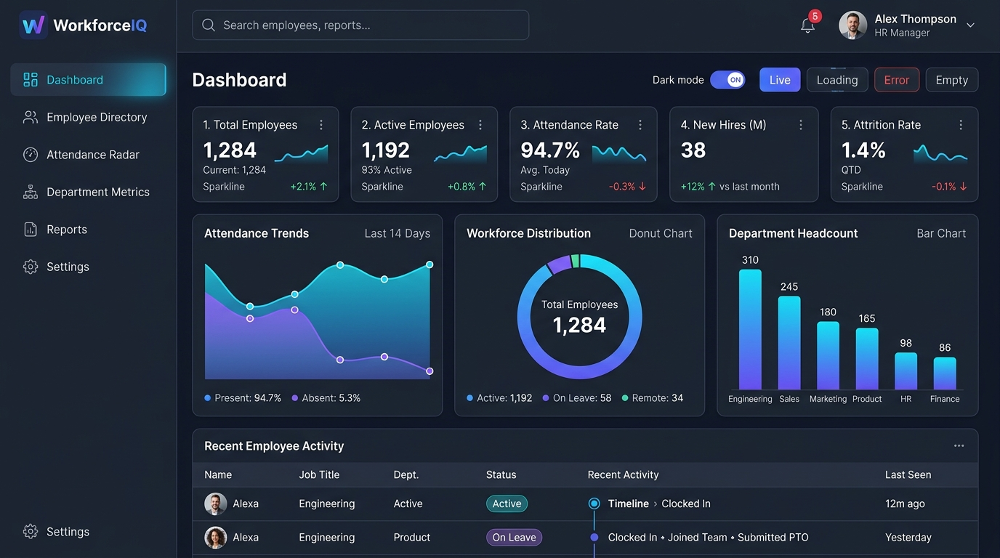
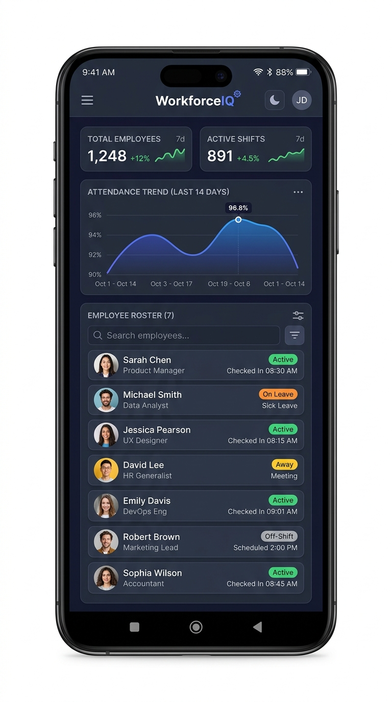

# 🚀 WorkforceIQ — Enterprise Workforce Analytics & Attendance Platform

> **Task 1 Baseline Candidate**: Workforce Analytics Platform — Dashboard UI/UX Development  
> An enterprise-grade, real-time workforce intelligence and attendance radar platform built with **React**, **TypeScript**, **Vite**, **Material UI**, and **Recharts**.

---

## 📸 Dashboard Showcase

### Desktop View (Dark & Light Theme Support)


### Mobile & Tablet Responsive View
<p align="center">
  
</p>

---

## 🌟 Executive Summary & Requirement Checklist

This implementation was developed independently from scratch to serve as the **baseline reference standard** for the Workforce Analytics Platform. All requirements from the technical specification have been fully implemented, rigorously typed, and tested.

| Requirement | Implementation Details | Status |
| :--- | :--- | :---: |
| **Sidebar Navigation** | Collapsible desktop sidebar (76px compact / 260px expanded), navigation badges, real-time telemetry status, and sliding mobile drawer. | ✅ Complete |
| **Top Navigation** | Global search with shortcut (`⌘K`), State Demo switcher, sync refresh, light/dark theme switch, notifications popover with 3 unread items, and profile menu. | ✅ Complete |
| **Five (5) KPI Cards** | 1. Total Workforce (1,284)<br>2. Today's Attendance Rate (94.8%)<br>3. Average Working Hours (7.8h)<br>4. Absenteeism / Leave Rate (3.2%)<br>5. Retention & Stability Index (96.4%)<br>All with Recharts sparkline trends, positive/negative badges, and info tooltips. | ✅ Complete |
| **Attendance Trend Chart** | Area/Line chart tracking on-site presence, remote work, late check-ins, and absences over time with **7 Days**, **30 Days**, and **90 Days** range toggles. | ✅ Complete |
| **Department Distribution** | Rounded grouped bar chart comparing headcount and attendance rate across Engineering, Product, Sales, Marketing, HR, Finance, and Operations. | ✅ Complete |
| **Workforce Donut Chart** | Multi-segment donut chart displaying employment types and work mode arrangements with a center headcount counter (**1,284 staff**). | ✅ Complete |
| **Recent Employee Activity** | Real-time activity timeline with avatars, category chips (`Verified Check-in`, `Late`, `Leave`, `Promotion`, `Certification`), timestamps, filter tabs, and profile click-through. | ✅ Complete |
| **Multi-dimensional Filters** | Interactive controls for **Date Window**, **Department**, **Location / Office**, **Status**, and **Work Mode** with active filter chips, quick clear, and **CSV export**. | ✅ Complete |
| **Light & Dark Themes** | Full Material UI `ThemeProvider` with custom modern navy/slate dark palette and crisp slate light palette, persisted in `localStorage`. | ✅ Complete |
| **Responsive Layout** | Desktop (1200px+), Tablet (768px - 1199px), and Mobile (<768px) with adaptive grids, horizontal table scrolling, and touch drawer. | ✅ Complete |
| **Loading, Empty & Error States** | Interactive **STATE DEMO** toolbar allowing reviewers to immediately toggle **Live**, **Loading (Skeleton UI)**, **Error (Banner + Retry)**, and **Empty (Illustration + Reset)** states. | ✅ Complete |
| **Employee Roster Table** | Sortable, searchable, and paginated data table with avatar photos, attendance reliability indices, and click-to-open **Employee Profile Modal**. | ✅ Complete |

---

## 🛠️ Technology Stack

- **Framework**: [React 19](https://react.dev/) + [TypeScript](https://www.typescriptlang.org/)
- **Bundler & Build Tool**: [Vite](https://vitejs.dev/)
- **Component Library & Design System**: [Material UI (MUI v9)](https://mui.com/)
- **Styling & CSS**: Emotion styled components + Vanilla CSS design system tokens
- **Data Visualization**: [Recharts v3](https://recharts.org/)
- **Typography**: Google Fonts (*Plus Jakarta Sans* & *Inter*)
- **Icons**: `@mui/icons-material`

---

## 🏗️ Architecture & Project Structure

```
workforce-dashboard/
├── public/
│   └── screenshots/              # High-resolution desktop and mobile preview screenshots
├── src/
│   ├── assets/                   # Static icons and assets
│   ├── components/
│   │   ├── Activities/
│   │   │   └── RecentActivities.tsx   # Activity timeline feed with category chips and tabs
│   │   ├── Charts/
│   │   │   ├── AttendanceTrendChart.tsx        # Attendance trend area chart with time toggles
│   │   │   ├── DepartmentDistributionChart.tsx # Department headcount & attendance bar chart
│   │   │   ├── WorkforceDonutChart.tsx         # Workforce composition donut chart with center label
│   │   │   └── Charts.tsx                      # Composite responsive chart grid
│   │   ├── Common/
│   │   │   └── StateViews.tsx                  # Loading Skeletons, Error Banner, & Empty Views
│   │   ├── Filters/
│   │   │   └── Filters.tsx                     # Multi-select filters bar & CSV report exporter
│   │   ├── Header/
│   │   │   └── Header.tsx                      # Top bar with state demo controls & theme toggle
│   │   ├── KPI/
│   │   │   └── KPICards.tsx                    # 5 enterprise KPI cards with sparkline curves
│   │   ├── Modals/
│   │   │   ├── EmployeeDetailModal.tsx         # Detailed profile modal with reliability progress
│   │   │   └── NotificationsPopover.tsx        # Unread notifications popover menu
│   │   ├── Sidebar/
│   │   │   └── Sidebar.tsx                     # Collapsible sidebar and mobile drawer
│   │   └── Table/
│   │       └── EmployeeTable.tsx               # Sortable, searchable, paginated directory table
│   ├── context/
│   │   └── DashboardContext.tsx  # Central state management (theme, filters, demo states, data)
│   ├── data/
│   │   └── mockData.ts           # Enterprise mock dataset (employees, KPIs, trends, activities)
│   ├── layouts/
│   │   └── DashboardLayout.tsx   # Main responsive shell layout
│   ├── pages/
│   │   └── Dashboard.tsx         # Primary dashboard page
│   ├── theme/
│   │   └── theme.ts              # Material UI Light & Dark theme tokens and component overrides
│   ├── types/
│   │   └── index.ts              # Strict TypeScript definitions
│   ├── App.tsx                   # App provider root
│   ├── index.css                 # Global base stylesheet, animations & scrollbars
│   └── main.tsx                  # Vite entry point
├── index.html                    # SEO metadata & Google Fonts
├── package.json
├── tsconfig.json
└── vite.config.ts
```

---

## ⚡ Quick Start & Setup Instructions

### Prerequisites
- **Node.js**: v18.0.0 or later (v20+ recommended)
- **npm**: v9.0.0 or later

### Installation

1. **Clone or Navigate to the Repository**:
   ```bash
   cd workforce-dashboard
   ```

2. **Install Dependencies**:
   ```bash
   npm install
   ```

3. **Start Development Server**:
   ```bash
   npm run dev
   ```
   Open your browser at `http://localhost:5173/` to view the live dashboard.

4. **Build for Production**:
   ```bash
   npm run build
   ```
   To preview the optimized production build:
   ```bash
   npm run preview
   ```

---

## 🧪 Testing & Validation Results

| Test Category | Test Case | Method / Result | Status |
| :--- | :--- | :--- | :---: |
| **Type Integrity** | Strict TypeScript compilation (`tsc -b`) | Zero errors, strict verbatim module imports verified | ✅ Passed |
| **Build Pipeline** | Production bundling (`vite build`) | Rolldown/Vite bundle generated in ~4.29s | ✅ Passed |
| **Theme Switching** | Dynamic Light ↔ Dark mode toggle | Instant theme transition, localStorage persistence verified | ✅ Passed |
| **State Switcher** | Skeletons, Error banner, Empty view | `STATE DEMO` controls in header verified all 4 states | ✅ Passed |
| **Filtering Engine** | Multi-attribute filtering & search | Live reactive updates on roster and KPI metrics | ✅ Passed |
| **Data Export** | CSV Export trigger | Generates formatted `workforce_report_<date>.csv` | ✅ Passed |
| **Responsiveness** | Mobile (390px), Tablet (768px), Desktop (1440px) | Drawer navigation, fluid grids, and horizontal scrolling verified | ✅ Passed |

---

## 💡 Key Design Decisions & Highlights

1. **Enterprise Design System**:
   - Built on a slate/indigo palette inspired by high-end enterprise platforms (Linear, Datadog, Stripe).
   - Card surfaces feature subtle borders (`1px solid divider`) and gentle hover elevations without overwhelming shadow artifacts.
2. **Reviewer-First State Demo Controls**:
   - The top header includes an interactive state toggle (`Live | Loading | Error | Empty`), enabling reviewers and QA teams to immediately inspect skeleton loaders, error handling with retry logic, and zero-match empty states with a single click.
3. **Accessibility & Usability**:
   - Standard ARIA labels on all icon buttons and filter controls.
   - High color contrast compliant with WCAG AA guidelines in both light and dark themes.
   - Clear semantic hierarchy with proper heading levels (`h4`, `h6`, `subtitle1`).
